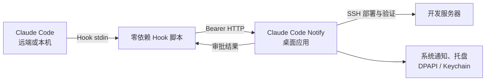
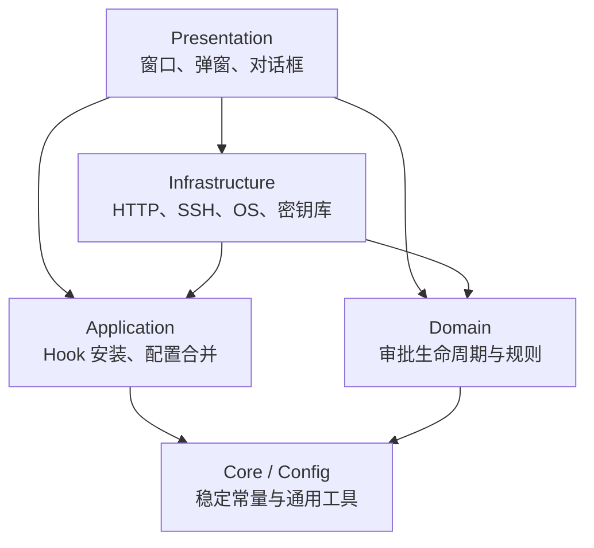

# Claude Code Notify

[](https://github.com/hfwang0318/claude-code-notify/actions/workflows/quality.yml)
[](https://www.python.org/)
[](#运行环境)
[](#运行环境)

让远端或本机运行的 Claude Code 在需要权限审批、提出问题或完成当前阶段时，
及时提醒你，并支持直接在桌面置顶弹窗中完成处理。

Claude Code Notify 是一个基于 Python 与 PySide6 的跨平台桌面应用。它在开发机
运行本地 HTTP 服务，通过 Claude Code Hooks 接收远端服务器或本机 Claude Code
的事件。关闭主窗口后，应用会继续驻留在系统托盘。

## 核心功能

- **桌面快速审批**：在置顶弹窗中允许、拒绝或交回终端处理权限请求。
- **AskUserQuestion 代答**：Claude 提问时可以直接在桌面弹窗中选择答案。
- **系统通知模式**：只发送系统通知，审批仍在原终端完成。
- **阶段完成提醒**：Claude 完成当前阶段后始终使用置顶弹窗提醒；开始下一轮
  对话时自动关闭。
- **远端一键部署**：通过 SSH 上传 Hook、合并 `settings.json` 并验证网络连接。
- **本机一键接入**：自动配置同一台计算机上的 Claude Code Hooks。
- **审批统计**：记录本次运行期间的审批数量，并按工具类型展示明细。
- **多屏与多桌面支持**：支持主屏、鼠标所在屏幕和 Windows 焦点窗口屏幕；
  macOS 弹窗可跟随当前 Space。
- **安全凭证存储**：Windows 使用 DPAPI，macOS 使用登录 Keychain 保存可选的
  SSH 密码。
- **失败安全**：网络异常、超时或应用退出时，Claude Code 会回退到终端处理，
  不会因桌面端故障卡死。

## 工作原理



两种通知方式：

| 模式 | Claude Code 事件 | 桌面行为 | 处理位置 |
|---|---|---|---|
| 应用置顶弹窗 | `PermissionRequest` | 弹出审批窗口 | 桌面或终端 |
| 系统通知中心 | `Notification` | 系统通知/托盘气泡 | 原终端 |

阶段完成提醒独立于通知方式。开启后，`Stop` 事件显示置顶提醒，
`UserPromptSubmit` 事件关闭对应会话的提醒。

## 运行环境

桌面端：

- Python 3.10 或更高版本
- Windows 10/11 或 macOS
- 可用的系统托盘

远端服务器：

- 已安装 Claude Code
- 可用 `python3`；服务器 Hook 只使用 Python 标准库
- 能够访问桌面端的 IP 和 TCP 端口 `18765`
- 一键部署功能需要 SSH 连接

Linux 会参与自动化测试，并提供基础平台兜底实现，但当前主要支持和打包目标是
Windows 与 macOS。

## 快速开始

### 1. 获取并启动应用

```bash
git clone https://github.com/hfwang0318/claude-code-notify.git
cd claude-code-notify

python -m venv .venv
```

Windows PowerShell：

```powershell
.\.venv\Scripts\Activate.ps1
python -m pip install -e .
claude-code-notify
```

macOS：

```bash
source .venv/bin/activate
python -m pip install -e .
claude-code-notify
```

也可以使用兼容入口启动：

```bash
python claude_notify_server.py
```

应用默认监听 `0.0.0.0:18765`，首次启动时会自动生成 Bearer Token，并保存到
`~/.claude-notify/token`。

### 2. 接入 Claude Code

如果 Claude Code 与桌面应用运行在同一台计算机：

1. 打开 Claude Code Notify。
2. 点击“本机接入”。
3. 选择“应用置顶弹窗”或“系统通知中心”。
4. 完成接入后重新启动 Claude Code；界面提示无需重启时以实际提示为准。

如果 Claude Code 运行在远端开发服务器：

1. 确保服务器能够访问界面中显示的桌面端 IP。
2. 在防火墙中允许服务器访问 TCP `18765`。
3. 点击“部署并验证”，填写 SSH 地址、用户名及认证信息。
4. 选择通知方式并执行部署。
5. 使用界面底部的测试通知或测试审批功能验证链路。

部署过程会备份远端 `~/.claude/settings.json`，然后幂等合并本项目的 Hook；
其他已有 Claude Code 配置会被保留。

> 如果服务器无法访问桌面端，先在服务器执行
> `curl http://<桌面端IP>:18765/health`。成功时应返回
> `{"status":"ok"}`。企业网络、VPN、NAT 和主机防火墙都可能阻断该连接。

## 构建桌面应用

### Windows

双击 `build_windows.bat`，或在命令行执行：

```bat
build_windows.bat
```

产物：

```text
dist\ClaudeCodeNotify.exe
```

### macOS

```bash
bash build_mac.sh
```

产物：

```text
dist/ClaudeCodeNotify.app
```

可选的精简构建：

```bash
LEAN=1 bash build_mac.sh
```

向其他 Mac 分发 `.app` 前，需要使用 Developer ID 签名并完成 notarization。

Windows 构建脚本当前要求项目根目录存在 `app.ico`；macOS 缺少 `app.icns`
时会使用默认应用图标。两个 Hook 脚本必须随应用一同打包，构建脚本已自动处理。

## 架构

项目采用 **模块化单体 + 端口适配器**。桌面端仍是单个进程，但业务规则、
用例、外部系统适配器和 Qt 展示层保持单向依赖。



```text
claude_code_notify/
├── domain/             # 审批领域模型与并发完成规则
├── application/        # Hook 配置生成和幂等合并用例
├── infrastructure/     # HTTP、SSH、本机接入、平台与密钥库适配器
├── presentation/       # PySide6 主窗口、弹窗、对话框、组件和主题
├── core.py             # 无框架通用工具
├── config.py           # 稳定协议、路径和进程常量
└── app.py              # 进程启动与崩溃边界

claude_notify_server.py # 旧启动与导入兼容门面
claude_approval_hook.py # 审批、提问和阶段状态 Hook
claude_notify_hook.py   # 单向通知和阶段状态 Hook
```

平台差异集中在 `infrastructure/platform.py`、
`infrastructure/local_integration.py` 和 `infrastructure/secrets.py`。
Presentation 层不直接判断 Windows 或 macOS。

完整设计见 [0 层架构文档](docs/architecture/00-l0-architecture.md)，协议、配置和
维护说明见 [项目文档](项目文档.md)。

## 开发与测试

安装开发依赖：

```bash
python -m pip install -e .
python -m pip install ruff
```

运行测试和静态检查：

```bash
python -m unittest discover -s tests -v
python -m ruff check claude_code_notify claude_notify_server.py tests
python -m compileall -q claude_code_notify claude_notify_server.py \
  claude_approval_hook.py claude_notify_hook.py
```

Linux 无界面环境运行 GUI 测试时：

```bash
QT_QPA_PLATFORM=offscreen python -m unittest discover -s tests -v
```

GitHub Actions 会在 Windows、macOS 和 Ubuntu 上运行相同的质量检查。

主要架构约束：

- `domain` 和 `application` 不依赖 PySide6。
- `infrastructure` 不依赖 `presentation`。
- Presentation 不直接导入平台和进程实现细节。
- Hook 脚本保持零第三方依赖，异常时必须安全回退。
- `claude_notify_server.py` 只保留兼容入口，不新增业务代码。

## 数据与安全

桌面端数据保存在 `~/.claude-notify/`：

| 文件 | 说明 |
|---|---|
| `token` | HTTP Bearer Token |
| `claude-notify.log` | 运行日志 |
| `deploy_config.json` | SSH 部署表单缓存 |
| `ui_config.json` | 界面偏好 |
| `startup-crash.log` | 启动异常日志，仅发生异常时生成 |

请注意：

- 服务监听局域网地址，HTTP 流量默认不加密。只应在可信网络中使用；跨不可信
  网络时请增加 TLS 反向代理或安全隧道。
- 不要公开 Token，也不要把 `~/.claude-notify/` 提交到版本库。
- 重新生成 Token 后，远端或本机现有 Hook 配置中的旧 Token 会立即失效，
  需要重新执行接入或部署。
- 当前没有强制单实例；重复启动会因端口占用导致服务启动失败。

## 常见问题

### 关闭窗口后应用为什么仍在运行？

这是预期行为。应用会最小化到系统托盘，以便继续接收 Claude Code 事件。
请从托盘菜单选择“退出”来完全结束应用。

### 审批弹窗超时后会怎样？

桌面端不会擅自允许或拒绝请求。超时、关闭弹窗或通信失败时，处理权会回到
Claude Code 原终端。

### 为什么远端部署成功但没有弹窗？

依次检查：

1. 桌面应用是否仍在托盘运行。
2. 远端能否访问 `http://<桌面端IP>:18765/health`。
3. 防火墙、VPN 或路由是否允许远端访问端口 `18765`。
4. Token 是否在生成后发生过变化。
5. Claude Code 是否已加载最新的 `~/.claude/settings.json`。

### Token 会保存到哪里？

桌面端 Token 位于 `~/.claude-notify/token`。部署时会写入对应 Hook 配置；
可选的 SSH 密码不会以明文形式保存，Windows 使用 DPAPI，macOS 使用 Keychain。
