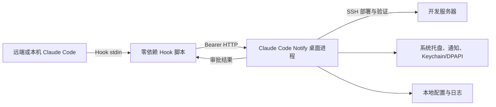
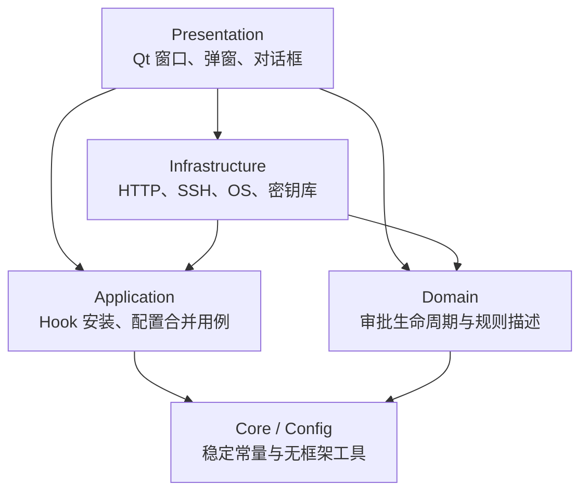

# Claude Code Notify 0 层架构

> 状态：已实施  
> 架构版本：3.0  
> 目标：在保持 Hook 协议、HTTP API、桌面交互和打包入口兼容的前提下，让功能可以按边界独立演进。

## 1. 系统边界

Claude Code Notify 是一个模块化单体桌面应用。它不拆成多个后台服务，仍以一个
Python/Qt 进程部署；“0 层架构”描述系统与外界的稳定边界，内部再通过分层和端口
隔离变化。

系统承诺的稳定入口：

- Hook 事件：`Notification`、`PreToolUse`、`PermissionRequest`、`Stop`、
  `UserPromptSubmit`
- HTTP：`/health`、`/claude-notify`、`/claude-approval`、
  `/claude-approval-resolved`、`/claude-stage-status`
- 启动兼容入口：`python claude_notify_server.py`
- 服务器端 Hook 脚本只使用 Python 标准库，异常路径静默回退到终端

## 2. 分层与依赖方向

依赖只能向内：

| 层 | 可以依赖 | 禁止依赖 |
|---|---|---|
| `domain` | 标准库、`core` | PySide6、`infrastructure`、`presentation` |
| `application` | 标准库、`core/config` | PySide6、`infrastructure`、`presentation` |
| `infrastructure` | `domain/application/core/config`、外部库 | `presentation` |
| `presentation` | 上述所有内层 | 其他具体窗口反向调用主窗口类型 |
| 兼容入口 | 各模块公开符号 | 新增业务实现 |

`tests/test_architecture.py` 会在 CI/本地测试中自动验证这些规则。

## 3. 模块划分

| 模块 | 单一职责 |
|---|---|
| `config.py` | 进程、协议、路径常量 |
| `core.py` | Token、资源路径、文本与网络工具 |
| `domain/approval.py` | `ApprovalRequest` 生命周期、建议/规则描述 |
| `application/hooks.py` | Hook 命令、settings.json 幂等合并、本机接入配置 |
| `infrastructure/http_server.py` | HTTP 路由、鉴权、长轮询和 Qt 信号桥 |
| `infrastructure/deployment.py` | SSH 部署与远程验证 |
| `infrastructure/local_integration.py` | Windows/POSIX 本机 Hook 安装、权限、验证与环境变量适配 |
| `infrastructure/platform.py` | Windows/macOS/Linux 平台端口 |
| `infrastructure/secrets.py` | DPAPI、Keychain、空实现 |
| `presentation/approval_popup.py` | 权限审批弹窗 |
| `presentation/stage_popup.py` | 阶段完成弹窗 |
| `presentation/components.py` | 可复用 Qt 组件 |
| `presentation/dialogs.py` | 部署与本机接入对话框 |
| `presentation/main_window.py` | 主窗口状态编排，不承载协议解析 |
| `presentation/theme.py` | 视觉常量与 QSS |
| `app.py` | 进程启动和崩溃边界 |
| `claude_notify_server.py` | 旧入口兼容门面，不承载业务代码 |

## 4. 关键运行时数据流

### 权限审批

1. Hook 把 Claude Code 输入适配为 HTTP 请求。
2. HTTP 适配器创建领域对象 `ApprovalRequest`。
3. 信号桥把请求投递到 GUI 线程。
4. 展示层收集决定并调用领域对象的 `finish()`。
5. HTTP 线程返回决定；异常、断连、超时均回退终端。

### 阶段完成

1. `Stop` 上报 `completed`，HTTP 层只校验并转发事件。
2. 主窗口按 `session_id` 创建或更新阶段完成弹窗。
3. `UserPromptSubmit` 上报 `resumed`，关闭同会话弹窗。
4. 此流程不读取通知方式配置，继续保持与通知/审批模式解耦。

### 部署

1. 对话框只收集并校验输入。
2. `DeployWorker` 通过 SSH 适配器上传 Hook。
3. `application/hooks.py` 生成并幂等合并配置。
4. 部署适配器执行语法、网络和远端配置验证。

## 5. 长期演进规则

- 新协议先落在 `domain/application`，再增加 HTTP、Hook 或 UI 适配。
- 新平台只能实现平台端口，不能在窗口类中散落 `sys.platform` 分支。
- Presentation 不得导入 `sys`、`os`、`platform` 或 `subprocess`；
  本机接入统一依赖 `LocalIntegrationAdapter`。
- 新窗口不得直接解析 HTTP payload 或操作 SSH。
- Hook 脚本保持独立、零第三方依赖；不要导入桌面应用包。
- 对外路径、事件名或响应结构的变更必须提供兼容期和协议回归测试。
- 单个模块超过 2000 行必须拆分；架构测试会阻止重新回到巨型单文件。
- `claude_notify_server.py` 只做重导出和启动兼容，禁止放入新功能。

## 6. 本次迁移策略

本次重构采用“兼容门面 + 一次性实体迁移”：

- 保留所有既有类名和函数名的顶层导入。
- 保留 PyInstaller 入口、Hook 文件名、数据目录和配置格式。
- 对旧测试常用的 `PLATFORM`、`UI_CONFIG_FILE` monkeypatch 做同步代理。
- 现有功能测试作为迁移验收基线，并新增分层依赖测试。

后续功能应直接导入所属模块；顶层兼容门面计划长期保留，但不再增长。
